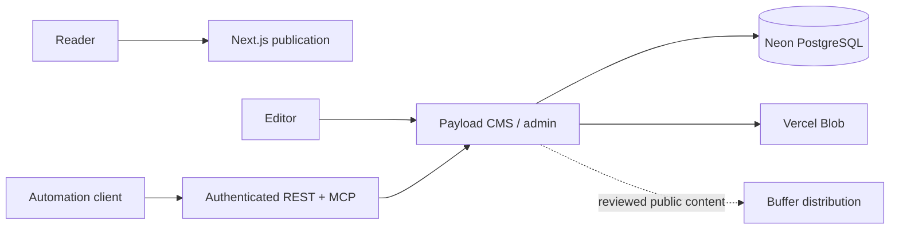

<!-- appfactory:hero:start -->
<div align="center">

# Trigenys Insight

### Research deserves a newsroom. Not just a feed.

**An independent bilingual publication and source-aware editorial platform for African technology, digital business and systems that shape decisions.**

[](#project-status)
[](#editorial-production-flow)
[](#stack)
[](#publishing-automation)
[](#capabilities-and-limits)

[**Why Insight**](#why-trigenys-insight) · [**Editorial flow**](#editorial-production-flow) · [**Architecture**](#architecture-and-trust-model) · [**Capabilities**](#capabilities-and-limits) · [**Stack**](#stack) · [**Publishing**](#publishing-automation) · [**Status**](#project-status)

</div>

---
<!-- appfactory:hero:end -->

## Why Trigenys Insight

**A credible publication is more than an article feed.** Trigenys Insight combines public technology and business reporting with a private editorial workspace for source tracking, translation/localization, media and scheduled publication. The focus is research readers can trace, not inflated traffic claims.

**Public publication:** [insight.trigenys.com](https://insight.trigenys.com/) · [Legacy Vercel deployment](https://trigenys-insight.vercel.app/).

## Editorial production flow

1. **Research:** register source links, editorial categories and authored context.
2. **Draft:** compose in **FR/EN**, with images, charts, takeaways and SEO metadata.
3. **Review and schedule:** distinguish a saved draft from a scheduled or published article.
4. **Distribute intentionally:** submit approved public content to Buffer; a pending export or draft is not a delivered social publication.
5. **Measure and refine:** treat source verification and discoverability as repeatable editorial operations, not a promise of audience reach.

See [automation guide](docs/publishing-automation.md) and [social distribution boundary](docs/buffer-distribution.md).

## Architecture and trust model



Payload serves public pages and admin workflows through one Next.js application. Private source registries, API tokens and research operations remain on trusted server boundaries; an automation correlation key alone is not a permission grant.

## Capabilities and limits

- **Implemented contracts:** bilingual articles, author and category metadata, source references, media, charts, draft/schedule/publish operations and authenticated SDK/MCP access. [Evidence](docs/publishing-automation.md).
- **External social workflow:** Buffer draft creation, editing and scheduling with idempotency, receipts and explicit publication timestamps. [Evidence](docs/buffer-distribution.md).
- **Operational limits:** a working scheduled publishing API does not establish that every intended article was published. A Buffer draft is neither automatically scheduled nor proof of publication on LinkedIn or Facebook.
- **Editorial constraints:** automated text and SEO metadata still require human verification of sources, originality and claims.

## Stack

- Next.js 16 App Router and React 19
- Payload CMS 3
- PostgreSQL 17 on Neon (PostgreSQL 16 also supported locally)
- TypeScript and Tailwind CSS 4
- Vitest and Playwright
- Vercel Blob for media storage

Payload lives inside the Next.js application: the public publication is served at `/`, the editorial workspace at `/admin`, and the REST and GraphQL APIs under `/api`.

## Publishing automation

The authenticated `/api/editorial-os` API supports drafts, immediate publication,
FR/EN content, verified media uploads, inline image and chart blocks, author/category
selection, source references, SEO, takeaways and FAQs. The same contract is exposed
as a TypeScript SDK and an MCP server (stdio or `/api/mcp` Streamable HTTP).

Read [the automation guide](docs/publishing-automation.md) for setup and examples.

## Editorial model

- `posts`: localized articles with drafts, scheduled publishing, SEO, reading time, featured state and traceable sources
- `categories`: localized editorial pillars and visual accents
- `research-sources`: private source registry used by the newsroom
- `reports`: free or premium research reports with methodology and source links
- `newsletter-subscribers`: consent records created only through the public subscription endpoint
- `media`, `users`, `pages`: assets, editorial accounts and evergreen pages

Business scoring and research computation do not live in browser components. When that layer becomes necessary, it should be implemented as a server-side research service and persist reproducible results for Payload to publish.

## Local setup

Requirements: Node.js 20+, pnpm 9+ and PostgreSQL 16 (or Docker).

```bash
cp .env.example .env
docker compose up -d
pnpm install
pnpm db:migrate
pnpm dev
```

Open `http://localhost:3000/admin`, create the first administrator, then use the dashboard seed action on a new database.

## Quality checks

```bash
pnpm lint
pnpm test:int
pnpm test:e2e
pnpm build
```

## Production

Set `DATABASE_URL` (pooled), `DATABASE_URL_UNPOOLED` (direct), `PAYLOAD_SECRET`, `CRON_SECRET`, `PREVIEW_SECRET`, `NEXT_PUBLIC_SERVER_URL` and `BLOB_READ_WRITE_TOKEN`. The Blob token is injected automatically when a Vercel Blob store is connected to the project.

Migrations are committed in `src/migrations`. On Vercel they are applied automatically: the `vercel-build` script runs `pnpm run db:migrate` (direct connection) before `next build`, on the Neon branch of each environment. See `docs/deployment.md`. Outside Vercel, run the same steps:

```bash
pnpm db:migrate
pnpm build
pnpm start
```

Automatic schema push is disabled in every environment. For future schema changes, run `pnpm db:migrate:create`, review the generated migration, and test it on a development branch before production. Never run rollback or reset commands on production without a backup and an explicit recovery plan.

See the [database model](docs/database-model.md) for the logical ER model and design decisions, and [deployment notes](docs/deployment.md) for Neon environments and remaining launch setup.

## Project status

**Status: Production.**

Current work focuses on editorial cadence, article discoverability and keeping the research/source workflow reproducible as the publication grows.

## Origin

The visual language and initial editorial backlog were migrated from the original Figma Make React/Vite mockup stored in the Trigenys project archive. The public brand remains **TRIGENYS INSIGHTS**; the GitHub repository keeps the historical singular name `Trigenys-Insight`.
